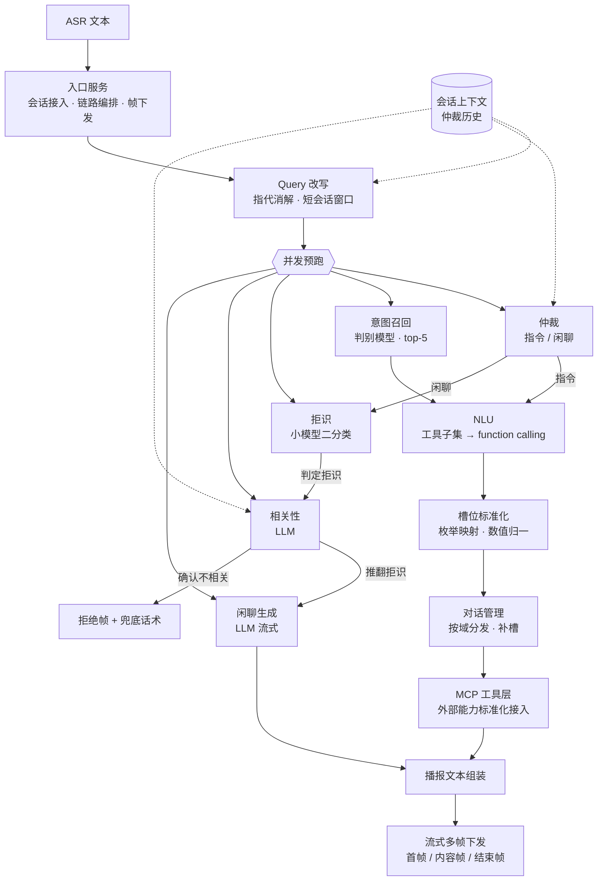

<div align="center">

# AutoAgent-MCP

**面向智能终端的任务型语音对话 Agent：小模型守门、意图召回收敛工具集、LLM 负责语义、MCP 负责执行。**

设计说明 · 不含源码

</div>

---

## 关于这份文档

这里记录的是这套系统的**设计判断与取舍**，不包含实现代码。

之所以只留思路：语音 Agent 的工程难点几乎不在算法选型，而在**如何把"技能太多"这件事拆成可收敛的层级**。
想清楚了，换一个领域、换一套底座、换一个团队都能重做一遍；没想清楚，拿到代码也只是抄了一个形状。

下面所有结论都可以迁移到智慧屏、智能音箱、家居中控、车机等任何"技能数百、每句话只命中一两个"的场景。

---

## 一、问题的本质：技能数量与延迟的对抗

终端可控制的部件、可打开的应用、可调用的服务累计数百项：空调温度、车窗天窗、座椅角度、氛围灯、
音量亮度、导航目的地、影音内容、通讯录、日程、车况查询……

如果把这些技能全量塞进一次 LLM 调用的工具列表，会产生三个直接后果：

1. **延迟不可接受**——工具定义本身就有十几万 token，首字延迟从百毫秒级涨到秒级；
2. **误匹配率上升**——相似技能（"打开车窗" / "打开天窗" / "打开车窗一点缝"）互相干扰；
3. **无法拒识**——用户说了句不该响应的话（车内闲聊、电视声音、无意义短句），系统仍会强行匹配到某个技能。

所以真正要设计的不是"模型怎么调"，而是**分层收敛的策略**：先用毫秒级判别模型把意图收敛到 top-5，
再把 top-5 对应的工具子集交给 LLM 做精确的 function calling。

一句话：**小模型负责把范围缩小，大模型负责在范围内做对。**

这个分工之所以成立，是因为两件事的成本结构完全不同——分类是毫秒级、可高并发的；
function calling 要串一次大模型调用，是整条链路的性能瓶颈。把不该给大模型做的活儿提前挡掉，
比优化大模型调用本身收益大得多。

---

## 二、架构



四个环节在部署上拆成独立进程、通过 HTTP 契约耦合：入口、NLU、意图召回、拒识。
好处是每个环节可以单独压测、单独扩容、单独换模型——语音链路的瓶颈位置会随流量形态变化，
耦合在一起的系统没法只扩瓶颈那一段。

---

## 三、四个关键设计

### 3.1 并发预跑 + 单一判定点：把延迟藏在并发里

一次请求要经过改写、仲裁、拒识、意图召回、LLM 生成五步。串行执行的总延迟是各步之和；
这里的做法是**先改写，然后把五路全部丢进线程池并发预跑**。

关键洞察是：五路里**只有仲裁的结论真正决定走哪条分支**。所以让仲裁独占一个超时预算（2 秒），
其余四路"先跑着"，被选中的分支直接取结果，未选中的丢弃。

用户感知到的延迟就取决于最慢的那条路径，而不是五条路径之和。

代价是算力浪费——平均有一半以上的预跑结果会被丢掉。这个交换在语音场景是划算的：
**首字延迟是体验的硬指标，GPU 空闲不是**。而且被浪费的那几路大多是小模型推理，成本远低于等待。

闲聊分支额外做了**流式分帧**：开始帧 → 内容帧 → 结束帧，首字到达即可播报，不必等整段生成完。

### 3.2 意图召回 × 工具收敛：数百个技能如何动态路由

核心链路只有四步：

```
query → 判别模型意图分类 → top-5 意图 ID
      → 意图映射到 function 名
      → 从工具表捞出这批 function 的全部工具定义（约 20~40 个）
      → 只把这批工具交给 LLM 做 function calling
```

三个值得记下来的细节：

- **短句高置信度短路**：top-1 命中"未知"且置信度极高时直接返回，**完全不调 LLM**。
  语音输入里有一大类是环境噪声、电视声、半句话，这类请求根本不值得占用大模型。
- **一个 function 名可能对应多个工具变体**（同一技能的不同默认参数），所以映射结构是
  `名称 → 工具列表` 而非一对一。召回阶段要把变体一并展开，否则会漏掉带默认参数的那一版。
- **工具子集是收敛点，不是过滤器**。它的作用是给 LLM 一个"只能在这几个里选"的封闭域，
  而不是从全量里挑几个——后者本质上还是让大模型做分类，等于把前面省下的成本又花回去了。

这套结构保住了全量技能覆盖，同时把单次调用的工具列表压到可控规模。

### 3.3 双模型守门：让系统学会"不响应"

语音场景里，**正确拒识和正确识别同等重要**。误触发一次（车里聊天被当成指令）造成的体验损失，
远大于漏识别一次（用户再说一遍就行）。

这里用两层性质不同的判据：

**第一层 · 判别式拒识。** 用极小的模型做二分类，输入当前 query，输出"是否应当响应"。
毫秒级推理，可以无条件前置，不占延迟预算。

**第二层 · 多轮相关性确认。** 关键设计：**拒识判为"不响应"时不立即丢弃**，而是交给 LLM 判断
这句话与上一轮对话是否相关。若相关，**推翻拒识结论**继续处理。

这一层解决的是单轮模型的结构性盲区：上一轮在聊音乐，这一轮只说"换一首"——
单看这句话它确实不完整、不像指令，但它在上下文里是完全合理的。没有第二层，这类请求会被稳定误杀。

相关性判断上还有两条**零成本规则前置**：与上一轮 query 完全一致直接判相关；上一轮是技能执行而非闲聊，
直接判不相关，不进 LLM。规则能挡掉的量不小，而规则的边际成本是零。

### 3.4 MCP + 流式多帧：执行与播报解耦

外部能力统一通过 **MCP（Model Context Protocol）** 接入：地图类能力（地理编码、逆地理、
IP 定位、天气、骑行/步行/驾车/公交路径规划）由一个 MCP server 暴露，音乐搜索由另一个暴露。

MCP 在这里的价值不是"用了新协议"，而是**把工具契约从 Agent 主链路里摘出去**：
新增一个能力域只需实现一个 server 并在客户端注册，不动 NLU 主链路。
对技能数持续增长的终端场景，这个边界比任何性能优化都重要。

执行结果交给对话管理（DM）与 NLG 组装成播报文本，再按帧下发：

| 帧类型 | 语义 | 用途 |
|---|---|---|
| 首帧 | 本次请求的意图与技能已确定 | 客户端可立即准备播报 |
| 内容帧 | 流式文本增量 | 逐句下发，降低感知延迟 |
| 结束帧 | 收尾 | 携带总耗时 |
| 拒绝帧 | 拒识或异常 | 携带兜底话术 |

---

## 四、链路上的三个细节

**Query 改写：短窗口是特性不是限制。**
改写模块把上一轮问答拼成对话块，只有存在历史时才调 LLM，否则直接判"无需改写"。
会话上下文存在 Redis 里，**TTL 只有 40 秒**——终端场景下用户一句说完到下一句通常不超过这个窗口。
过期的上下文必须主动丢掉，否则十分钟前的话题会被拽回当前请求。宁可漏改写一次，也不要错改写一次。

**仲裁：唯一必须等待的环节。**
仲裁是整条链路里唯一"不出结果就没法继续"的地方，因此给它明确的 2 秒超时和 6 轮历史窗口。
超时或异常时**走闲聊分支**——可用性优先。这里的选择不是技术性的：
指令分支误判会操作错误硬件，闲聊分支误判只是答得不对，后者的代价明显更低。

**NLU：宁可返回未知，也不要猜错。**
提示词里有一条硬约束：输入里没指明要操作的部件时，**不允许匹配到任何操作部件的函数**，
必须返回未知函数。比如"打开这个"就应该匹配到未知。

这是为了压制语音口语里大量省略主语的表达（"打开一下""关掉它"）。猜错部件会直接操作错误的硬件，
而返回未知只会走兜底话术——**在物理世界里，沉默比错误动作安全**。

---

## 五、槽位标准化：下游要枚举，不要自然语言

槽位解析之后还有一步必做的归一化：位置枚举（主驾 / 副驾 / 吹脸吹脚 → 固定枚举值）、
百分比归一（`50%` → `0.5`）、数值类型转换。

这一步的意义在于**把"语言理解"和"设备执行"之间的契约固定下来**。
执行层拿到的是干净的枚举，不是自然语言字符串——否则每一个执行模块都要自己做一遍解析，
错误会以最不可控的方式分散到各处。

同样的思路用在对话管理上：天气、音乐、地图三域各有独立 DM，由工厂按域分发。
DM 负责补槽与多轮延续：用户先说"导航去机场"，再补一句"走高架"，
DM 要在保留目的地的前提下更新路线偏好，而不是重新解析成一次独立请求。

---

## 六、评测口径

评测分两类脚本：一类打准确率（逐条顺序调用服务并统计），一类打并发（压测）。

历史上自测得到的量级（**学习期间的本地记录，非可复现基准**）：

| 环节 | 指标 | 量级 |
|---|---|---|
| 意图召回（判别模型） | acc@1 | 0.85 左右 |
| 拒识（判别模型） | accuracy | 0.90 左右 |
| NLU（LLM function calling） | 意图准确率 | 0.86 左右 |
| NLU（LLM function calling） | 槽位准确率 | 0.91 左右 |
| 多轮端到端 | 整轮正确率 | 0.88 左右（人工标注口径） |

需要说明的是：这几组数字来自不同环节、不同时间点的独立评测，**不是同一次全链路压测的结果**，
口径不可横向比较。端到端一档按"一轮内意图与全部槽位均正确即算对"的人工标注口径统计。

关于压测有个有意思的结论：意图召回是纯 CPU 推理，可以开上千并发压；NLU 要串一次 LLM 调用，
压测并发只能给到十位数。**这两个数字本身就是整条链路的瓶颈所在**——不需要看任何火焰图，
从可压的并发量级就能判断该优化谁。

多轮端到端坚持人工标注而不是自动比对，理由很实际：同一意图可以有多种正确的播报表达，
自动字符串匹配会把大量正确回答判成错误。而槽位对不对、播报切不切题，人看一眼就知道。
二十分钟的人工成本换来的口径可信度，比省下来的时间更值。

---

## 七、已知边界

- **技能域仍带座舱语义**。意图体系覆盖的是设备控制类指令（空调、车窗天窗、座椅、氛围灯、音量亮度、
  应用与媒体、导航出行），提示词里的角色设定也保留了车况相关措辞。
  这套结构对智慧屏、智能音箱、家居中控同样成立——换领域时改的是意图表、工具表与若干提示词，**不动链路本身**。
- **单机部署**。入口服务用的是线程模型的 Socket.IO，适合单机中等并发；
  生产环境需要换成带事件循环的 WSGI 或独立消息队列。
- **会话状态单点**。上下文、仲裁历史、改写历史都放在一个缓存实例上，没有做持久化与降级策略，
  缓存不可用时链路会整体退化。
- **闲聊分支有兜底话术**。LLM 不可用或返回为空时统一回一句"这个问题我还在学习中"，
  不做重试也不降级到检索。
- **模型权重与训练数据不随文档提供**。这里给的是结构与参数选择，不是开箱即用的权重。

---

## 八、如果重做一次

1. **把"预跑五路"改成按流量形态自适应**。现在是全量预跑，闲聊高峰期会浪费很多算力。
   更好的做法是根据历史分布决定预跑哪几路——低频分支可以退化成串行。
2. **拒识与相关性合成一个模型**。现在是两级串联，第二级还要串 LLM。理论上可以训一个
   带上下文的拒识模型，把"结合上文判断该不该响应"做成单步。
3. **工具子集的边界要能被评测**。现在 top-5 是个经验值，但"该技能是否落在 top-5 内"这个指标
   比 acc@1 更贴近真实体验——因为漏召回一个技能，用户看到的就是"它不会"。
